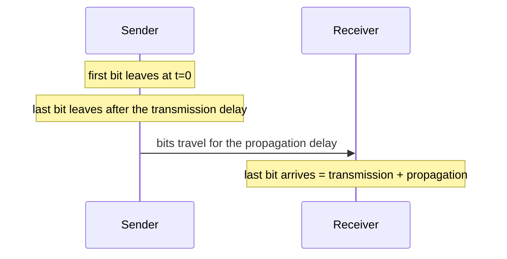

# Lesson 1: Network Performance and Delays

[← Back to index](../README.md) · [Next: Switching →](02-switching.md)

## The big idea

When you send a packet, it takes time to get there. That time is made up of a few separate **delays**, and each one has its own cause. Exam questions ask you to work them out, so you need to know the difference.

> **Analogy:** a lorry delivering goods.
> - **Transmission delay** is how long the lorry takes to pass through the toll gate. A longer lorry (a bigger packet) takes longer, and a wider gate (more bandwidth) is quicker.
> - **Propagation delay** is the drive along the motorway. It depends only on the distance and the speed, not on the size of the lorry.
> - **Queueing delay** is waiting in the traffic jam at the gate.

## 1. Bandwidth

**Bandwidth** (or **bit rate**) is how many bits a link can push out per second, for example 10 Mb/s = 10,000,000 bits per second.

## 2. Transmission delay

The time to put **all the bits** of a packet onto the link.

```
Transmission delay = packet size (bits) ÷ bandwidth (bits/s)
```

**Example:** a 160-byte packet at 20 Mb/s:
- 160 × 8 = 1,280 bits
- 1,280 ÷ 20,000,000 = 0.000064 s = **64 µs**

⚠️ Always convert **bytes to bits** first (× 8).

## 3. Propagation delay

The time for **one bit** to travel along the wire.

```
Propagation delay = link length (m) ÷ signal speed (m/s)
```

**Example:** 60 km at 300,000 km/s → 60 ÷ 300,000 = 0.0002 s = **200 µs**

✅ Propagation does **not** depend on the packet size or the bandwidth.
✅ Transmission does **not** depend on the length of the link.

## 4. Total packet delay on one link

```
Packet delay = transmission delay + propagation delay (+ queueing delay)
```



**Example (from the quiz solutions):** a 180 B packet, 10 Mb/s, 15 µs propagation
- Transmission = 1,440 ÷ 10,000,000 = 144 µs
- Total = 144 + 15 = **159 µs**

## 5. Round-trip time (RTT)

The time to go **there and back**. The course quiz solutions use:

```
RTT = 2 × (transmission + propagation)
```

**Example:** 250 B, 125 Mb/s, 73.75 km at 295 million m/s
- Transmission = 2,000 ÷ 125,000,000 = 16 µs
- Propagation = 73,750 ÷ 295,000,000 = 250 µs
- RTT = 2 × (16 + 250) = **532 µs**

## 6. Bandwidth-delay product (BDP)

How many bits **fit on the wire** at once, which is the "capacity" of the link.

```
BDP = bandwidth × propagation delay   (bits)
```

**Example:** 80 Mb/s × 4 µs = **320 bits**

## 7. How many packets are on the link?

This is asked as "packets *stored* on the link" or "packets transmitted and propagating before the first bit arrives".

```
Packets on link = ⌊ propagation delay ÷ transmission delay ⌋     (round down)
```

**Example:** 60 km at 300,000 km/s, 2 Gb/s, 800-byte packets
- Propagation = 200 µs
- Transmission = 6,400 ÷ 2,000,000,000 = 3.2 µs
- 200 ÷ 3.2 = 62.5 → **62**

## 8. Other quick formulas from the quizzes

| What | Formula | Example |
|---|---|---|
| Upload time | file size (bits) ÷ bit rate | 2,000 KB at 4 Mb/s = 16,000,000 ÷ 4,000,000 = **4 s** |
| CPU clock cycles during a trip | time × clock rate | 25 m there and back = 166.8 ns × 5 GHz ≈ **834** |
| Packet error probability | ≈ bits × bit-error probability | 1,500 B × 10⁻⁶ = 0.012 ≈ **1%** |

## What to remember

- Transmission = **size ÷ bandwidth**. Propagation = **length ÷ speed**.
- Convert bytes to bits (× 8) and keep your time units consistent (s, ms, µs).
- Doubling the bit rate halves the **transmission** delay, but **not** the total delay, because propagation stays the same.
- A bigger packet means a higher chance of a bit error.

---

## Quiz

**Q1.** What is the transmission delay of a 200-byte packet on a 20 Mb/s link?

<details><summary>Show answer</summary>

200 × 8 = 1,600 bits. 1,600 ÷ 20,000,000 = **80 µs**.
</details>

**Q2.** True or false: if the length of a link doubles, the transmission delay doubles.

<details><summary>Show answer</summary>

**False.** Length only affects the **propagation** delay. Transmission depends only on the size and the bandwidth.
</details>

**Q3.** A link is 45 km long, the propagation speed is 299,792,458 m/s, and the packet transmission time is 10 µs. How many packets can be stored on the link?

<details><summary>Show answer</summary>

Propagation = 45,000 ÷ 299,792,458 ≈ 150.1 µs. 150.1 ÷ 10 = 15.01 → **15 packets**.
</details>

**Q4.** True or false: a file 10 times as large as another, sent over 10 times the bandwidth, has the same transmission time.

<details><summary>Show answer</summary>

**True.** (10 × size) ÷ (10 × bandwidth) = size ÷ bandwidth.
</details>

**Q5.** A link is 250 km long, the speed is 280,000 km/s, the bit rate is 12 Mb/s, and packets are 200 B. How many packets are transmitted and propagating before the first bit arrives?

<details><summary>Show answer</summary>

Propagation = 250 ÷ 280,000 s ≈ 892.9 µs. Transmission = 1,600 ÷ 12,000,000 ≈ 133.3 µs. 892.9 ÷ 133.3 = 6.7 → **6**.
</details>

**Q6.** True or false: if the bit rate of a link is doubled, the overall packet delay is halved.

<details><summary>Show answer</summary>

**False.** Only the transmission part halves. The propagation delay doesn't change.
</details>
