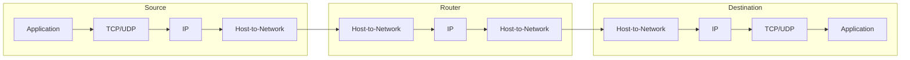

# Lesson 3: Layers and Encapsulation

[← Switching](02-switching.md) · [Index](../README.md) · [Next: Transport →](04-transport.md)

## The big idea

Networking is complicated, so it's split into **layers**. Each layer does one job and only talks to the layer directly above and below it.

> **Analogy:** sending a letter. You write the letter (application), put it in an envelope with an address (transport and network), and the post office moves it by van and plane (link and physical). You don't need to know how the plane works, and the pilot doesn't read your letter.

## 1. The OSI model: 7 layers

| # | Layer | Job |
|---|---|---|
| 7 | Application | Programs the user sees |
| 6 | Presentation | Data format, encryption |
| 5 | Session | Managing conversations |
| 4 | **Transport** | End-to-end delivery between processes, the **first end-to-end layer** |
| 3 | Network | Routing between networks |
| 2 | **Data Link** | Delivery across one link |
| 1 | Physical | Bits on the wire |

**Memory trick (from 7 down to 1):** *All People Seem To Need Data Processing*

## 2. The TCP/IP model: 4 layers

| TCP/IP layer | Protocols | OSI equivalent |
|---|---|---|
| **Application** | HTTP, FTP, TFTP, DNS | 7, 6, 5 |
| **Transport** | TCP, UDP | 4 |
| **Internet** | IP | 3 |
| **Host-to-Network** | Ethernet, Wi-Fi | 2, 1 |



The **router** only goes up to IP. Only the two end hosts have the transport and application layers. That's why the transport layer is called **end-to-end**.

## 3. Key facts about layering

- The actual communication is **vertical** (down one stack, across the wire, up the other), not horizontal.
- In a layered architecture, a layer **cannot** look inside other layers.
- **Encapsulation** means each layer wraps the data in its own header. It does **not** make the data secure.

## 4. SDU, PCI and PDU

These three terms describe what each layer does to the data:

| Term | Full name | Meaning |
|---|---|---|
| **SDU** | Service Data Unit | The data that comes **down from the layer above** |
| **PCI** | Protocol Control Information | The **header** this layer adds |
| **PDU** | Protocol Data Unit | **PCI + SDU**, what this layer passes down |

```
Transport layer:   [ Transport PDU (segment)            ]
                              ↓ becomes the
Network layer:     [ Network PCI | Network SDU          ]  = Network PDU
                              ↓ becomes the
Data Link layer:   [ DL PCI | Data Link SDU              ]  = Data Link PDU
```

### Rules to remember

- **N+1 PDU = N SDU.** The layer above's PDU is this layer's SDU.
- A Transport PDU **=** a Network SDU.
- **Adding** a Network PCI to a Transport PDU gives a **Network PDU**.
- **Removing** the Data Link PCI from a Data Link PDU gives a **Network PDU**.

### Common wrong statements

- ❌ "Extracting a Network PCI from a Transport PDU gives a Network SDU." The layers are mixed up: a Transport PDU has no Network PCI.
- ❌ "A Transport SDU is identical to a Network PDU." It's the other way round.

## 5. The Internet's design

- It gives a **best effort** service with **no guarantees**.
- It is **federated**, with no central control.
- It is **asynchronous**.
- Bandwidth varies by **billions**, and latency varies by **millions**.

---

## Quiz

**Q1.** How many layers are there in the OSI model, and how many in TCP/IP?

<details><summary>Show answer</summary>

OSI has **7** layers and TCP/IP has **4**. ("There are four layers in the OSI model" is false.)
</details>

**Q2.** Which is the first end-to-end layer in the OSI model?

<details><summary>Show answer</summary>

The **Transport** layer (layer 4).
</details>

**Q3.** True or false: a Network SDU is identical to a Transport PDU.

<details><summary>Show answer</summary>

**True.** The PDU from the layer above becomes the SDU of the layer below.
</details>

**Q4.** What do you get by removing the Data Link PCI from a Data Link PDU?

<details><summary>Show answer</summary>

A **Network PDU** (which is also the Data Link SDU).
</details>

**Q5.** True or false: encapsulation means the data is secure.

<details><summary>Show answer</summary>

**False.** Encapsulation only wraps the data in headers. It has nothing to do with security.
</details>

**Q6.** True or false: the Internet is designed to give guaranteed communication services.

<details><summary>Show answer</summary>

**False.** It is **best effort**, with no guarantees.
</details>
