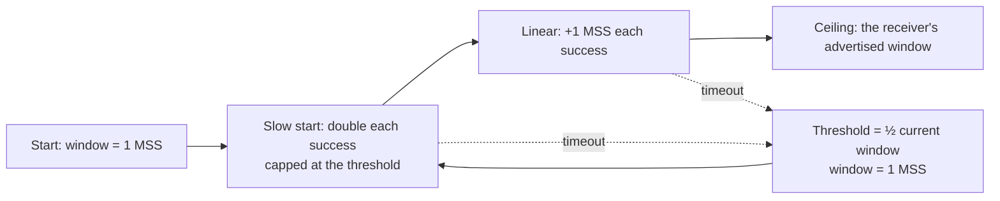

# Lesson 5: TCP Congestion Control

[← Transport](04-transport.md) · [Index](../README.md) · [Next: IPv4 addressing →](06-ipv4-addressing.md)

## The big idea

Nobody controls how fast each computer sends on the Internet. If everyone sends too fast, router queues overflow and packets get dropped. TCP's answer is to **start slowly, speed up while things go well, and back off hard when a packet is lost.**

> **Analogy:** joining a motorway in the dark. You start gently and speed up. If you see brake lights (a **timeout**), you slow right down, then build up again more carefully, remembering where the trouble was. That remembered point is the **threshold**.

## 1. The rules



1. **Start** with the window = **1 MSS**.
2. **Slow start:** after each successful burst, **double** the window. If doubling would pass the threshold, set it **to** the threshold.
3. **Linear increase:** once at or above the threshold, add **1 MSS** per successful burst.
4. **Ceiling:** the window never goes above the receiver's advertised window. If none is given, there's no cap.
5. **Timeout:** threshold = **½ × the current window** (the course rounds down), and the window goes back to **1 MSS**.

### Why is it called "slow start" when it doubles?

The *growth* is fast. The *start* is slow: it begins at 1 MSS instead of sending the receiver's whole window at once.

## 2. The method: always draw a table

| Burst | Amount sent | Window afterwards | Threshold |
|---|---|---|---|

"Window after the n-th transmission" means the value **after** row n.

## 3. Worked example

**MSS 5 kB, threshold 60 kB, receiver's window 100 kB, timeout on the 8th transmission. What is the window after the 13th?**

| Burst | Sent | Window afterwards | Threshold | Phase |
|---|---|---|---|---|
| 1 | 5 | 10 | 60 | slow start |
| 2 | 10 | 20 | 60 | slow start |
| 3 | 20 | 40 | 60 | slow start |
| 4 | 40 | **60** (80 capped) | 60 | slow start |
| 5 | 60 | 65 | 60 | linear |
| 6 | 65 | 70 | 60 | linear |
| 7 | 70 | **75** | 60 | linear |
| 8 | 75 | **5** | **37** (½ × 75, rounded down) | ⚠️ timeout |
| 9 | 5 | 10 | 37 | slow start |
| 10 | 10 | 20 | 37 | slow start |
| 11 | 20 | **37** (40 capped) | 37 | slow start |
| 12 | 37 | 42 | 37 | linear |
| 13 | 42 | **47** | 37 | linear |

**Answer: 47 kB.**

## 4. Timing questions

Each burst takes one **round-trip time** (RTT).

- **"How long before the first full window can be sent?"** Count the bursts **before** the full one, then multiply by the RTT.
  *MSS 3, threshold 22, window 30, RTT 15 ms:* 3, 6, 12, **22**, 25, 28, then **30**. That's 6 bursts before the full one, so 6 × 15 = **90 ms**.
- **"How long to send X KB?"** Keep a **running total**. The burst that takes the total past X is sent after (n − 1) RTTs.
  *MSS 4, threshold 50, window 80, RTT 15 ms, 400 KB:* the totals are 4, 12, 28, 60, 110, 164, 222, 284, 350, **420**. Burst 10 passes 400, so 9 × 15 = **135 ms**.

## 5. Throughput with a fixed window

```
Throughput = window ÷ RTT        (RTT = 2 × one-way delay)
```

**Example:** 131,072-byte windows, 10 ms one-way delay → 131,072 × 8 ÷ 0.02 s ≈ **52 Mb/s**

---

## Quiz

**Q1.** MSS 5 kB, threshold 70 kB, no receiver's window given. What is the window after the 7th transmission?

<details><summary>Show answer</summary>

Sent: 5, 10, 20, 40, 70 (80 capped at 70), 75, 80. After the 7th: 80 + 5 = **85 kB**.
</details>

**Q2.** The window is 41 kB when a timeout occurs. MSS = 3 kB. What is the window after 4 successful transmissions?

<details><summary>Show answer</summary>

Threshold = ⌊41 ÷ 2⌋ = 20. Sent: 3, 6, 12, 20 (24 capped). After the 4th: 20 + 3 = **23 kB**.
</details>

**Q3.** The window is 60 KB when a timeout occurs. The receiver's window is 64 KB and the MSS is 8 KB. What is the window after 7 successful transmissions?

<details><summary>Show answer</summary>

Threshold = 30. Sent: 8, 16, 30 (32 capped), 38, 46, 54, 62. After the 7th: 62 + 8 = 70, but it's capped at the receiver's window, so **64 KB**.
</details>

**Q4.** MSS 6 KB, threshold 50 KB, receiver's window 72 KB, timeout on the 7th transmission. What is the window after the 12th?

<details><summary>Show answer</summary>

Sent: 6, 12, 24, 48, 50 (capped), 56. The 7th sends 62 and times out, so threshold = 31 and window = 6. Then 8th sends 6 → 12, 9th sends 12 → 24, 10th sends 24 → 31 (capped), 11th sends 31 → 37, 12th sends 37 → **43 KB**.
</details>

**Q5.** True or false: in TCP the congestion window cannot be greater than the threshold.

<details><summary>Show answer</summary>

**False.** In the linear phase it grows past the threshold, up to the receiver's window.
</details>

**Q6.** RTT 10 ms, receiver's window 36 KB, threshold 20 KB, MSS 4 KB. How long until the first full window can be sent?

<details><summary>Show answer</summary>

Sent: 4, 8, 16, 20 (capped), 24, 28, 32, then 36 (full). That's 7 bursts before it, so 7 × 10 = **70 ms**.
</details>
