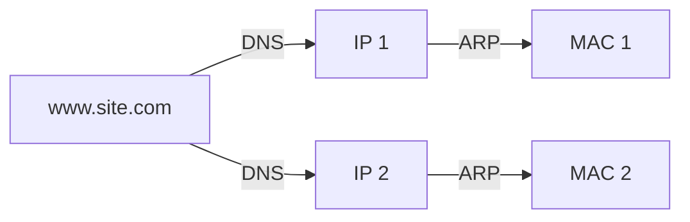

# Lesson 6: IPv4 Addressing

[← TCP congestion control](05-tcp-congestion.md) · [Index](../README.md) · [Next: Subnetting →](07-subnetting.md)

## The big idea

Every device (a **host**) on the Internet needs an **address** so packets can find it. An IPv4 address is like a postal address: part of it says **which network**, and the rest says **which device** on that network.

## 1. An IPv4 address is 32 bits

- It is written as **4 octets** (8-bit groups) of 0 to 255, separated by dots: `137.43.1.114`
- 2³² ≈ **4.3 billion** addresses, which is fewer than the world's population.
- IPv4 = **32 bits** (not 48; 48 bits is the length of a MAC address).

### Binary refresher

| Bit | 1st | 2nd | 3rd | 4th | 5th | 6th | 7th | 8th |
|---|---|---|---|---|---|---|---|---|
| Value | 128 | 64 | 32 | 16 | 8 | 4 | 2 | 1 |

**Decimal to binary:** go left to right. If the number is at least the place value, write 1 and subtract it; otherwise write 0.

217 → 217−128=89 (1), 89−64=25 (1), 25<32 (0), 25−16=9 (1), 9−8=1 (1), 0, 0, 1−1=0 (1) → `11011001`

⚠️ Any octet over 255 (e.g. `137.256.14.10` or `78.3.261.6`) is **not a real address**.

## 2. Network part and host part

```
137 . 43 . 1 . 114
|network | | host |
```

- **Network ID:** which network the address is on.
- **Host ID:** which device it is on that network.

## 3. Address classes (pre-1993)

Look at the **first octet only**:

| Class | First octet | Starts with (bits) | Network / host | Networks | Hosts each |
|---|---|---|---|---|---|
| **A** | 1–126 | `0` | N.H.H.H (/8) | 126 | 16,777,214 |
| **B** | 128–191 | `10` | N.N.H.H (/16) | 16,384 | 65,534 |
| **C** | 192–223 | `110` | N.N.N.H (/24) | 2,097,152 | 254 |
| D | 224–239 | `1110` | multicast | none | none |
| E | 240+ | `11110` | reserved | none | none |

- **127** is **loopback** (testing your own machine), which is why Class A is 1–126. The statement "Class A starts with 0–127" was marked false.
- There are **more** Class C networks than Class B, but each is much smaller.

## 4. Special addresses

| Host bits are… | Meaning | Usable by a host? |
|---|---|---|
| All **0s** | The network (or subnet) address itself | ❌ |
| All **1s** | **Broadcast** (sent to everyone on that network) | ❌ |
| Anything else | A normal host | ✅ |

That's why there are **2ⁿ − 2** usable hosts: you lose the all-0s and all-1s addresses.

## 5. Who assigns addresses?

- **ICANN** controls the assignment of **all** IP addresses.
- It delegates to regional registries: **RIPE NCC** (Europe), **APNIC** (Asia Pacific) and **ARIN** (Americas).
- ❌ RIPE does **not** assign all IP addresses, and it does **not** cover Asia Pacific.

## 6. Names, IPs and MACs

> Covered in full in [Lesson 12: Naming, DNS, ARP and MAC addresses](12-naming-dns-arp.md).



| Protocol | Converts |
|---|---|
| **DNS** | name → IP address(es) |
| **ARP** | IP → MAC (on the local network) |
| **RARP** | MAC → IP |

**True/false facts from the course key:**
- ✅ A hostname can have **many IPs**.
- ✅ An IP can support **many domain names**.
- ✅ A domain name can be resolved to **many MACs** (DNS, then ARP).
- ❌ An IP address can have multiple MACs.
- ❌ A MAC address can support many IPs.
- ❌ A MAC address is resolved by DNS to an IP. (DNS works on names; MAC → IP is RARP.)

---

## Quiz

**Q1.** Convert 172 to binary.

<details><summary>Show answer</summary>

128 + 32 + 8 + 4 = 172 → **10101100**
</details>

**Q2.** What class is 151.8.201.217, and what is its classful network ID?

<details><summary>Show answer</summary>

151 is in 128–191, so it's **Class B**. Network ID = **151.8.0.0**.
</details>

**Q3.** Which of these are valid host addresses? (a) 197.68.14.0 (b) 137.256.14.10 (c) 137.71.255.128

<details><summary>Show answer</summary>

(a) ❌ Class C, and the host part .0 is all zeros, so it's the network address. (b) ❌ 256 is too big for an octet. (c) ✅ Class B, host part 255.128, which isn't all 0s or all 1s.
</details>

**Q4.** True or false: there are more Class B networks than Class C networks.

<details><summary>Show answer</summary>

**False.** There are 16,384 Class B networks and 2,097,152 Class C networks.
</details>

**Q5.** True or false: an IP address 137.42.2.44 belongs to a Class C network.

<details><summary>Show answer</summary>

**False.** 137 is Class B.
</details>

**Q6.** How many usable hosts does a Class C network have?

<details><summary>Show answer</summary>

2⁸ − 2 = **254** (not 256).
</details>
